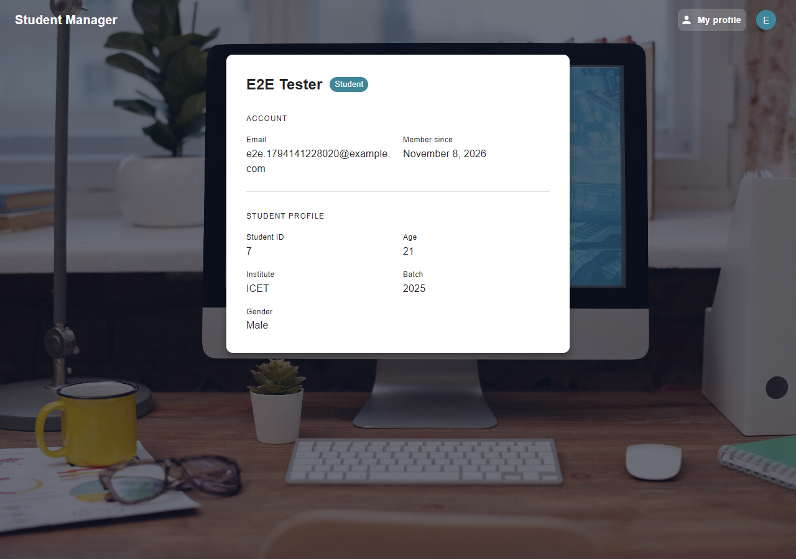
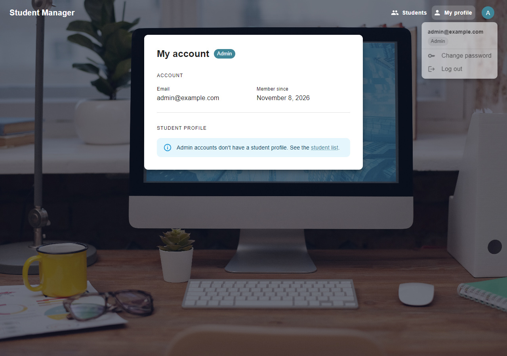
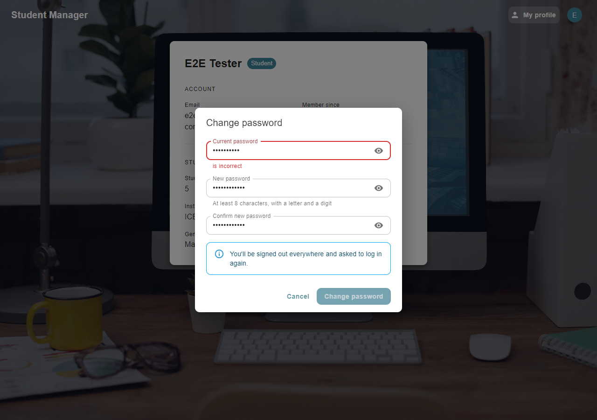

# Student Management System — Frontend

The web frontend for the Student Management System. Students register, sign in and see their own profile. Admins and lecturers sign in to see the list of registered students. It is a **React** single-page app built with **Vite** and styled with **MUI**, and it talks to the [Spring Boot backend](https://github.com/ThisukaMW/Student-management-backend) over REST, signing in with JWT access and refresh tokens.

## Tech stack

- React 19, React Router
- MUI (Material UI) with Emotion
- Vite
- ESLint

## Screenshots

| Register | Log in |
|---|---|
|  |  |

| My profile (student) | Account menu (admin) | Change password |
|---|---|---|
|  |  |  |

## Pages

| Route       | Who can open it        | Component                    | Purpose                                   | API calls |
|-------------|------------------------|------------------------------|-------------------------------------------|-----------|
| `/`         | guests                 | `src/pages/RegisterPage.jsx` | Student registration form                 | `POST /api/v1/auth/register` |
| `/login`    | guests                 | `src/pages/LoginPage.jsx`    | Sign in                                   | `POST /api/v1/auth/login`, `GET /api/v1/auth/me` |
| `/students` | ADMIN, LECTURER        | `src/pages/StudentsPage.jsx` | List of registered students (up to 100)   | `GET /api/v1/students` |
| `/profile`  | everyone signed in     | `src/pages/ProfilePage.jsx`  | Your account and, for students, your profile | `GET /api/v1/auth/me` |

**Where you land:**
- **Guests** opening a signed-in page are sent to `/login`.
- **After logging in** you return to the page you were trying to open, or to your home page: `/students` for admins and lecturers, `/profile` for students.
- **Students** opening `/students` are sent to `/profile`.
- **Signed-in users** opening `/` or `/login` are sent to their home page.
- **Any other URL** redirects to `/`.

These guards only decide what to show. The backend checks the role on every request, so a hidden page can't be reached by calling the API directly.

**Signed-in pages** share an app bar:
- **Navigation:** **Students** (staff only) and **My profile**. On phones these become labelled icons.
- **Account menu** (the avatar at the top right): shows your email and role, with **Change password** and **Log out**.

**Messages and errors:**
- Validation errors from the backend appear under the matching input; other errors appear in an alert at the top of the form.
- The login page explains why you're there: just registered (with your email filled in), session expired, logged out, or password changed.

## How sign-in works

The backend issues a short-lived **access token** (a JWT, valid for about 15 minutes) and a long-lived **refresh token** (7 days, single use). `src/api/client.js` handles both:

| | Where it's kept | How it's used |
|---|---|---|
| Access token | In memory only | Sent as `Authorization: Bearer <token>` on every signed-in request |
| Refresh token | `localStorage` (`studentManagement.refreshToken`) | Exchanged for a new pair when the access token expires, or after a page reload |

- **Expired access token:** a request that gets **401** refreshes the tokens once and is retried, so you're not interrupted.
- **Reload:** you stay signed in. `AuthProvider` trades the stored refresh token for a new access token, then loads your account from `/auth/me`.
- **Refreshes never overlap.** The backend treats a refresh token that's used twice as stolen and signs the user out everywhere. So the client runs one refresh at a time per tab (a shared promise) and across tabs (the [Web Locks API](https://developer.mozilla.org/docs/Web/API/Web_Locks_API)), and always uses the newest stored token. Several tabs and reloads are therefore safe.
- **Session can't be renewed** (refresh token expired or revoked): you're sent to `/login` with "Your session has expired".
- **Log out:** revokes the refresh token on the server and forgets both tokens.
- **Change password:** signs you out everywhere, because the backend revokes all refresh tokens. You're asked to log in again with your email filled in.

> **Security note:** a refresh token in `localStorage` can be read by any script running on the page, so it would be exposed if the site ever had an XSS hole. React escapes everything it renders, which keeps that risk low. The stronger option is an `httpOnly` cookie set by the backend, which would need backend changes.

## Project structure

```
src/
├── main.jsx                    → entry point: MUI theme, CssBaseline, AuthProvider, router
├── App.jsx                     → routes and route guards
├── theme.js                    → MUI theme (colours, button and input defaults)
├── api/client.js               → fetch wrapper, token handling and API calls
├── auth/
│   ├── AuthProvider.jsx        → session state: restore on reload, login, logout, why a session ended
│   ├── RequireAuth.jsx         → RequireAuth (signed-in / role guard) and PublicOnly (register, login)
│   ├── useAuth.js, context.js  → access to the session from any component
│   └── roles.js                → roles, labels and each role's home page
├── components/
│   ├── AppShell.jsx            → app bar, navigation and account menu for signed-in pages
│   ├── ChangePasswordDialog.jsx
│   ├── AuthLayout.jsx          → background image + centred card for register/login
│   ├── PasswordField.jsx       → password input with a show/hide toggle
│   └── FullPageLoader.jsx
├── pages/                      → one component per route
└── assets/                     → images
```

## Getting started

### Prerequisites

- Node.js 20.19+ or 22.12+ (required by Vite)
- The [backend](https://github.com/ThisukaMW/Student-management-backend#getting-started) running on `http://localhost:8080`, with `JWT_SECRET` set. To sign in as an admin, also set `ADMIN_EMAIL` and `ADMIN_PASSWORD` in the backend's `.env`; the first admin is created from them on startup.

### Run in development

```bash
npm install
npm run dev
```

Then open `http://localhost:5173`.

To try every role:
1. **Student:** register at `/` and you're a student.
2. **Admin:** log in with the backend's `ADMIN_EMAIL` and `ADMIN_PASSWORD`.
3. **Lecturer:** an admin creates one with `POST /api/v1/admin/users`. See the backend README for the curl command.

The dev server always uses port **5173**, because that is the origin the backend allows for CORS. If the port is taken, Vite stops with an error instead of silently switching to another port that the backend would reject.

### Other scripts

| Command           | What it does                                           |
|-------------------|--------------------------------------------------------|
| `npm run build`   | Production build into `dist/`                          |
| `npm run preview` | Serves the production build on `http://localhost:5173` |
| `npm run lint`    | Runs ESLint                                            |

### Pointing at a different backend

The API URL defaults to `http://localhost:8080/api/v1`. To change it, copy `.env.example` to `.env.local` and edit `VITE_API_BASE_URL`. If the frontend runs on another address, also add that address to `app.cors.allowed-origins` in the backend.

## Troubleshooting

| What you see | Cause and fix |
|--------------|---------------|
| "Cannot reach the server" | The backend isn't running on `http://localhost:8080`, or `VITE_API_BASE_URL` points somewhere else. |
| CORS error in the browser console | The page's address isn't in the backend's `app.cors.allowed-origins`. Use `http://localhost:5173`, not `127.0.0.1:5173`. |
| "Your session has expired" | The refresh token expired (after 7 days), was revoked, or the backend's `JWT_SECRET` changed. Log in again. |
| Signed out on every device at once | A refresh token was used twice, which the backend treats as theft. This can happen if you copy tokens between browsers by hand. Log in again. |
| Admin login fails right after setup | The backend only creates the first admin when `ADMIN_EMAIL` and `ADMIN_PASSWORD` are set *and* no admin exists yet. Check its startup log. |

## Related

- Backend: [Student-management-backend](https://github.com/ThisukaMW/Student-management-backend)
