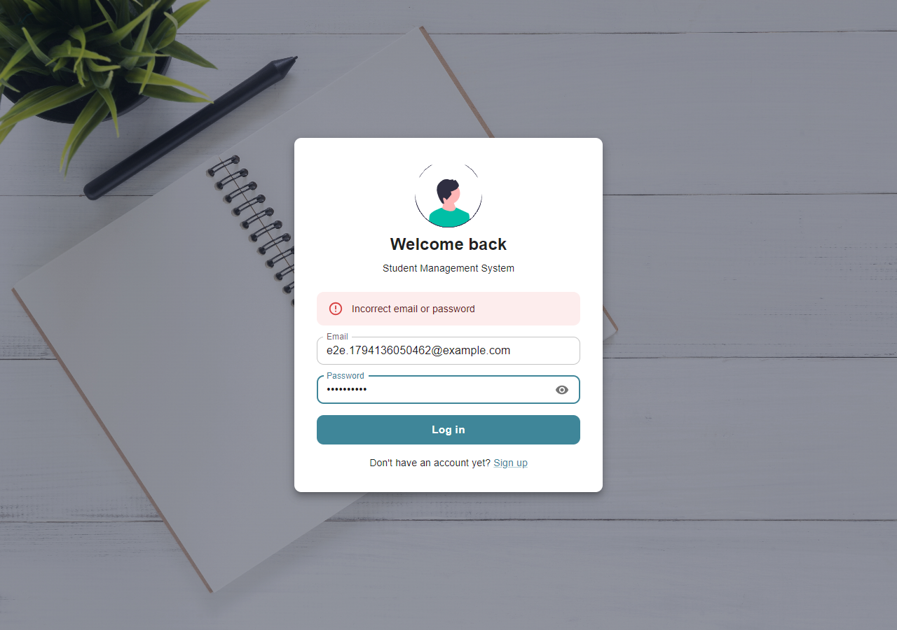

# Student Management System — Frontend

The web frontend for the Student Management System. Students can register and sign in through a responsive interface that talks to the [Spring Boot backend](https://github.com/ThisukaMW/Student-management-backend) over REST.

## Tech stack

- HTML5, CSS3, Bootstrap
- JavaScript (Fetch API)

## Pages

| File           | Purpose                          |
|----------------|----------------------------------|
| `index.html`   | Landing page                     |
| `login.html`   | Sign in and registration         |
| `content.html` | Main content page                |

JavaScript lives in `js/` (`app.js`, `login.js`, `main.js`) and styles in `css/`.

## Getting started

1. Start the backend first. See the [backend README](https://github.com/ThisukaMW/Student-management-backend#getting-started). It runs on `http://localhost:8080`.
2. Open `index.html` in your browser, or serve the folder with a tool such as the VS Code Live Server extension.

The frontend sends requests to `http://localhost:8080/information`.

## Screenshots

<!--  -->
<!--  -->

## Related

- Backend: [Student-management-backend](https://github.com/ThisukaMW/Student-management-backend)
