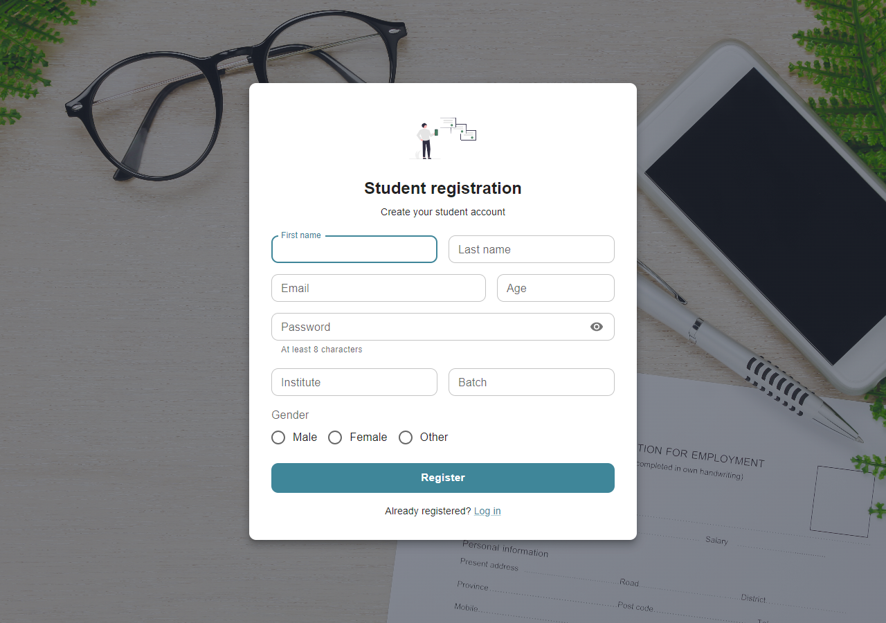
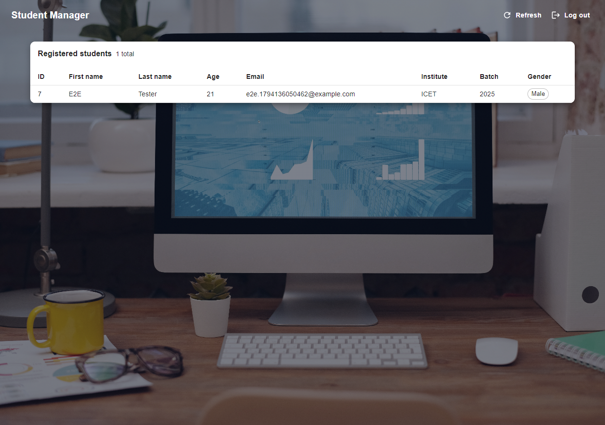

# Student Management System — Frontend

The web frontend for the Student Management System. Students can register, sign in and see the list of registered students. It is a **React** single-page app built with **Vite** and styled with **MUI**, and it talks to the [Spring Boot backend](https://github.com/ThisukaMW/Student-management-backend) over REST.

## Tech stack

- React 19, React Router
- MUI (Material UI) with Emotion
- Vite
- ESLint

## Screenshots

| Register | Log in | Students |
|---|---|---|
|  |  |  |

## Pages

| Route       | Component                      | Purpose                     | API call                  |
|-------------|--------------------------------|-----------------------------|---------------------------|
| `/`         | `src/pages/RegisterPage.jsx`   | Student registration form   | `POST /api/v1/students`   |
| `/login`    | `src/pages/LoginPage.jsx`      | Sign in                     | `POST /api/v1/auth/login` |
| `/students` | `src/pages/StudentsPage.jsx`   | List of registered students | `GET /api/v1/students`    |

Any other URL redirects to `/`.

- Validation errors from the backend are shown under the matching input; other errors appear in an alert at the top of the form.
- After registering, the login page opens with the email already filled in.
- The student list shows up to 100 students, the largest page the API allows.

## Project structure

```
src/
├── main.jsx                 → entry point: MUI theme, CssBaseline, router
├── App.jsx                  → routes
├── theme.js                 → MUI theme (colours, button and input defaults)
├── api/client.js            → fetch wrapper and API calls
├── components/
│   ├── AuthLayout.jsx       → background image + centred card for register/login
│   └── PasswordField.jsx    → password input with a show/hide toggle
├── pages/                   → one component per route
└── assets/                  → images
```

## Getting started

### Prerequisites

- Node.js 20.19+ or 22.12+ (required by Vite)
- The [backend](https://github.com/ThisukaMW/Student-management-backend#getting-started) running on `http://localhost:8080`

### Run in development

```bash
npm install
npm run dev
```

Then open `http://localhost:5173`.

The dev server always uses port **5173**, because that is the origin the backend allows for CORS. If the port is taken, Vite stops with an error instead of silently switching to another port that the backend would reject.

### Other scripts

| Command           | What it does                                           |
|-------------------|--------------------------------------------------------|
| `npm run build`   | Production build into `dist/`                          |
| `npm run preview` | Serves the production build on `http://localhost:5173` |
| `npm run lint`    | Runs ESLint                                            |

### Pointing at a different backend

The API URL defaults to `http://localhost:8080/api/v1`. To change it, copy `.env.example` to `.env.local` and edit `VITE_API_BASE_URL`. If the frontend runs on another address, also add that address to `app.cors.allowed-origins` in the backend.

## Related

- Backend: [Student-management-backend](https://github.com/ThisukaMW/Student-management-backend)
